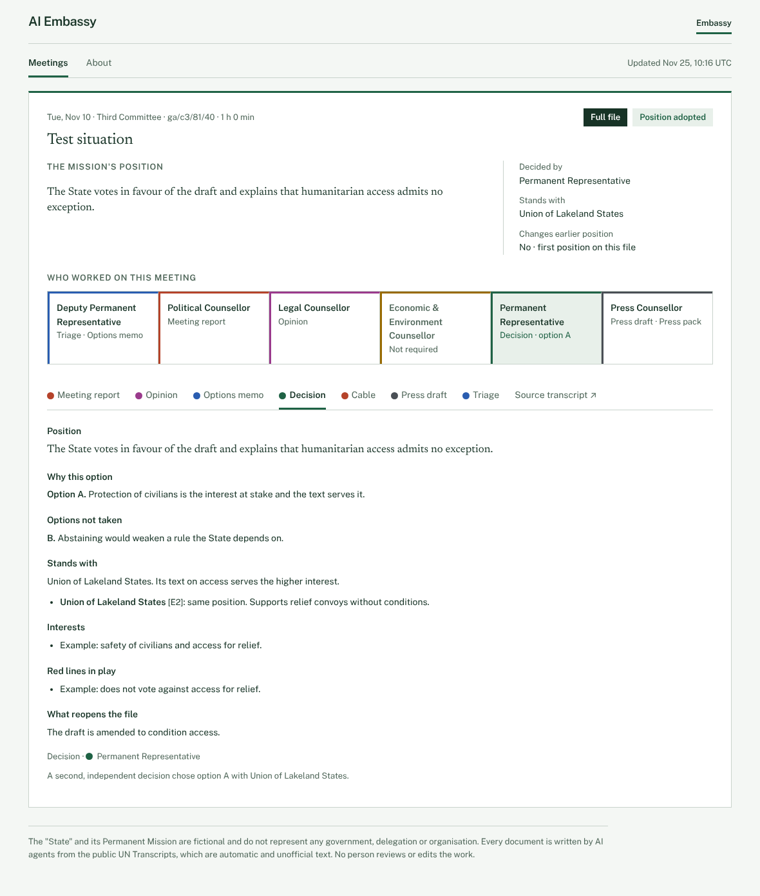

# AI Embassy

A user guide for building a mission of AI agents: a small team of agents in diplomatic roles that follows public
meetings, decides how much work each one deserves, and writes what a mission writes (notes, reports, opinions,
an options memo, a decision and a cable to the capital).

The method was developed and tested over several weeks on real, public United Nations meetings, with a fictional
State. It is a manual, not a product: it describes how such a mission can be built, and leaves the choice of
State, bodies and models to whoever reads it.


## Who it is for

- **Diplomats and mission staff** who want to see what such a team can and cannot do before anyone builds one.
  Start with the [guide](guide/). No code is needed to read it.
- **Teams that will build one**, for a mission, a ministry, a training course or a research project. The guide
  gives the principles; [`templates/`](templates/) gives the shape of every document; [`reference/`](reference/)
  is one working implementation, built on the public UN Transcripts.

## See it first



The page above comes from the demo, which runs the real engine and site on three invented meetings with a
scripted model in place of a real one. It needs no key and no network:

```sh
cd reference && npm ci && npm run demo    # http://127.0.0.1:3910
```

## What it does not do

- It reads only what was said in public meetings. It knows nothing of informal consultations, corridor
  conversations or instructions from a capital.
- It can show that a document is supported by its source and consistent with the State's profile. It cannot
  show that a position is wise.
- It cannot catch an error that is already in the source; automatic transcripts contain errors.
- It is not a source of record, and it speaks for no government. Every State in this repository is fictional.
- It does not replace the diplomat. [Chapter 7](guide/07-what-only-the-diplomat-can-add.md) is about what
  stays with people.

## The guide

1. [The idea and its limits](guide/01-the-idea-and-its-limits.md)
2. [Write the State's profile](guide/02-write-the-states-profile.md)
3. [Design the team of agents](guide/03-design-the-team-of-agents.md)
4. [Choose and prepare the source](guide/04-choose-and-prepare-the-source.md)
5. [Build the checks](guide/05-build-the-checks.md)
6. [Run it in the shadows and read the output](guide/06-run-it-in-the-shadows.md)
7. [What only the diplomat can add](guide/07-what-only-the-diplomat-can-add.md)

## Layout

```
guide/       seven short chapters, each ending with a checklist
templates/   an empty State profile and the structure of each document, with notes (invented content)
reference/   a reference implementation: one way to do it, not the only one
docs/img/    the flow figure and a page of the demo
```

## Author and citation

Written by Tono Pérez-Hernández, a diplomat covering AI governance and digital affairs. The views expressed are
his own and do not reflect those of his employer.

To cite it: Tono Pérez-Hernández, *AI Embassy: a user guide for building a mission of AI agents* (2026),
<https://github.com/antoniophd/aiembassy>.

## Licences

Code under the [MIT License](LICENSE). The guide, the templates and the documentation under
[CC BY 4.0](LICENSE-CONTENT.md). Questions and corrections: [issues](../../issues).
